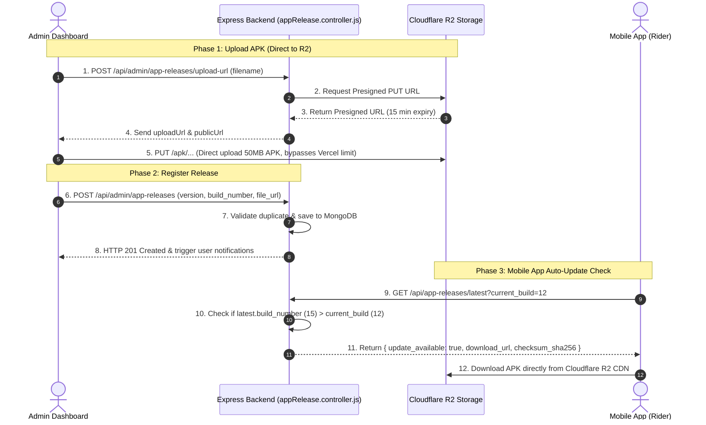

# 📱 App Release Controller (`appRelease.controller.js`) — Complete Line-by-Line Beginner Guide

> **File Location**: `Backend/src/controllers/admin/appRelease.controller.js`  
> **Target Audience**: Beginners, junior developers, and new team members  
> **What this file does**: Manages Android APK releases, Cloudflare R2 uploads, presigned direct-upload URLs, version updates, featured release selection, and public app update checks for mobile riders.

---

## 📑 Table of Contents

1. [High-Level Overview & Architecture](#1-high-level-overview--architecture)
2. [Key Concepts Dictionary (Beginner-Friendly)](#2-key-concepts-dictionary-beginner-friendly)
3. [Line-by-Line Quoted Code Breakdown](#3-line-by-line-quoted-code-breakdown)
   - [File Header & Module Imports](#31-file-header--module-imports-lines-1-8)
   - [Function 1: `getUploadUrl` (Lines 15–35)](#32-function-1-getuploadurl-lines-1535)
   - [Function 2: `createAppRelease` (Lines 42–132)](#33-function-2-createapprelease-lines-42132)
   - [Function 3: `getAppReleases` (Lines 139–171)](#34-function-3-getappreleases-lines-139171)
   - [Function 4: `updateAppRelease` (Lines 178–208)](#35-function-4-updateapprelease-lines-178208)
   - [Function 5: `deleteAppRelease` (Lines 215–238)](#36-function-5-deleteapprelease-lines-215238)
   - [Function 6: `selectFeaturedRelease` (Lines 246–276)](#37-function-6-selectfeaturedrelease-lines-246276)
   - [Function 7: `getLatestAppUpdate` (Lines 283–336)](#38-function-7-getlatestappupdate-lines-283336)
4. [Summary Flow Diagram](#4-summary-flow-diagram)

---

## 1. High-Level Overview & Architecture

In a mobile app ecosystem (like JustRide Rider App), when you build an updated version of your app:
1. The APK file is large (usually 20 MB to 100 MB).
2. Hosting providers like **Vercel** have a strict **4.5 MB request body limit** on serverless functions.
3. If an admin tries to upload a 50 MB APK directly through a Vercel-hosted Node.js endpoint, it immediately fails with `413 Payload Too Large`.

### How This Controller Solves It:
Instead of pushing large files through our Express server, we use **Presigned URLs**:
1. The admin panel asks the backend: *"Give me permission to upload a file called `justride-v1.2.0.apk` directly to Cloudflare R2 storage."*
2. The backend generates a temporary, cryptographically signed URL from Cloudflare R2 (`getUploadUrl`).
3. The admin dashboard uploads the APK file **directly to Cloudflare R2**.
4. Once uploaded, the admin calls `createAppRelease` with the file URL and metadata.
5. When riders open the JustRide app, the app calls `getLatestAppUpdate` to check if a newer build number is available.

---

## 2. Key Concepts Dictionary (Beginner-Friendly)

If any of these terms are unfamiliar, here is an easy-to-understand explanation:

### 1. Cloudflare R2 & Object Storage
- **What it is**: Cloudflare R2 is an Amazon S3-compatible file storage system. You store files as "objects" inside a "bucket".
- **Why R2 instead of AWS S3**: AWS charges expensive "egress fees" (fees every time a user downloads a file). Cloudflare R2 charges **zero egress fees**, making it free or ultra-cheap to distribute thousands of 50 MB APK downloads to riders.

### 2. Presigned URL (Direct-to-Cloud Upload)
- **Concept**: A temporary URL generated by the server that contains a cryptographic signature.
- **Analogy**: Think of it as a VIP one-time entry ticket with a 15-minute timer. Anyone holding this ticket can upload exactly one file directly into your Cloudflare R2 bucket without knowing your master secret access keys.
- **Why we use it**: It bypasses the Vercel 4.5 MB upload limit and saves server memory and CPU.

### 3. SHA-256 Checksum
- **Concept**: A unique 64-character fingerprint created from the binary bytes of a file (e.g., `e3b0c44298fc1c149afbf4c8996fb92427ae41e4649b934ca495991b7852b855`).
- **Why it matters**: If even 1 single bit changes during download, the checksum changes completely. The mobile app uses this to verify:
  1. The download was not corrupted midway.
  2. A hacker did not modify or replace the APK with malicious code.

### 4. Semantic Version vs. Build Number
- **`version` (e.g., "1.2.0")**: A human-friendly label. Strings are dangerous to compare because alphabetically `"1.10.0"` is smaller than `"1.2.0"`.
- **`build_number` (e.g., `42`)**: A simple positive integer that strictly increases with every build (`1, 2, 3, ... 42, 43`). The app simply checks: `if (latest.build_number > current_build) { show_update(); }`.

### 5. Mongoose `.lean()`
- **Concept**: By default, Mongoose wraps query results in heavy Mongoose Document instances with methods, change tracking, and getters/setters.
- **Why `.lean()`**: Calling `.lean()` tells Mongoose to return a plain, lightweight JavaScript object `{}`. It runs **3x to 5x faster** and consumes significantly less RAM.

### 6. Mongoose `.populate()`
- **Concept**: In MongoDB, documents reference each other by `ObjectId`.
- **Why `.populate()`**: It works like an SQL `JOIN`. It replaces `released_by: "66e...123"` with `{ _id: "66e...123", full_name: "Admin User", email: "admin@justride.com" }`.

### 7. MongoDB Operators: `$set` and `$ne`
- **`$set`**: Updates only the specified fields without overwriting the rest of the document.
- **`$ne`**: Stands for "Not Equal". Example: `{ _id: { $ne: release._id } }` means *"find all documents where `_id` is NOT this release's ID"*.

### 8. Fire-and-Forget Async Execution
- **Concept**: Notice line 120: `releaseNotifier.notifyAppRelease(release).catch(...)` without an `await`.
- **Why**: Sending push notifications to 10,000 riders takes 5 to 10 seconds. We do NOT make the admin wait for 10 seconds; we return the HTTP response immediately and let the notification service finish in the background.

---

## 3. Line-by-Line Quoted Code Breakdown

---

### 3.1 File Header & Module Imports (Lines 1–8)

```javascript
1: /**
2:  * controllers/admin/appRelease.controller.js
3:  * Comprehensive Mobile App APK Release Management on Cloudflare R2
4:  */
5: const AppRelease      = require("../../models/AppRelease.model");
6: const audit           = require("../../security/auditLogger");
7: const cloudflareR2    = require("../../services/cloudflareR2.service");
8: const releaseNotifier = require("../../services/releaseNotification.service");
```

#### Line-by-Line Explanation:
- **Line 1–4**: File comment stating the file purpose: handling mobile app APK releases on Cloudflare R2.
- **Line 5 (`const AppRelease = require(...)`)**: Imports the Mongoose model representing the `appreleases` collection in MongoDB. This gives us database query functions like `.create()`, `.find()`, `.exists()`, etc.
- **Line 6 (`const audit = require(...)`)**: Imports the audit logging utility. Whenever an admin creates, updates, or deletes a release, an immutable security record is created for accountability.
- **Line 7 (`const cloudflareR2 = require(...)`)**: Imports the Cloudflare R2 service wrapper containing S3 SDK commands (`PutObjectCommand`, presigned URL generation, etc.).
- **Line 8 (`const releaseNotifier = require(...)`)**: Imports the notification service that sends automated push notifications to mobile app riders when a new update is released.

---

### 3.2 Function 1: `getUploadUrl` (Lines 15–35)

> **Goal**: Provide the admin frontend with a temporary, secure URL so the admin's browser can upload a large APK directly to Cloudflare R2, bypassing server limits.

```javascript
15: exports.getUploadUrl = async (req, res, next) => {
16:   try {
17:     const { filename, content_type } = req.body;
18:     if (!filename) {
19:       return res.status(400).json({ success: false, message: "filename is required" });
20:     }
21: 
22:     const cleanFilename = filename.replace(/[^a-zA-Z0-9._-]/g, "_");
23:     const r2Key = `apk/${Date.now()}-${cleanFilename}`;
24:     const contentType = content_type || "application/vnd.android.package-archive";
25: 
26:     const presigned = await cloudflareR2.getUploadPresignedUrl(r2Key, contentType);
27: 
28:     res.status(200).json({
29:       success: true,
30:       data: presigned,
31:     });
32:   } catch (error) {
33:     next(error);
34:   }
35: };
```

#### Line-by-Line Explanation:
- **Line 15**: Exports the asynchronous controller function `getUploadUrl`. It accepts standard Express parameters `(req, res, next)`.
- **Line 16**: `try {` begins a protected block to catch runtime errors.
- **Line 17**: Destructures `filename` and `content_type` from the incoming JSON request body (`req.body`).
- **Line 18–20**: Validates whether `filename` was provided. If missing, immediately halts and returns HTTP `400 Bad Request`.
- **Line 22 (`cleanFilename = filename.replace(/[^a-zA-Z0-9._-]/g, "_")`)**:
  - **Concept (Regex Sanitization)**: Files from user computers might contain spaces or illegal URL characters like `my app release (v1).apk`. This regular expression replaces all characters that are NOT alphanumeric, dots, underscores, or hyphens with an underscore `_`.
- **Line 23 (`const r2Key = \`apk/\${Date.now()}-\${cleanFilename}\`;`)**:
  - **Concept (Collision Prevention)**: Generates the unique storage path inside the R2 bucket. `Date.now()` is the current millisecond timestamp (e.g., `1726508900123`). This guarantees that even if two admins upload `app.apk` at the same time, their files will have unique keys and never overwrite each other.
- **Line 24 (`const contentType = content_type || "application/vnd.android.package-archive";`)**:
  - Sets the MIME type. If the client did not send one, it defaults to `"application/vnd.android.package-archive"`, the official standard MIME type for Android `.apk` files.
- **Line 26 (`const presigned = await cloudflareR2.getUploadPresignedUrl(r2Key, contentType);`)**:
  - Calls Cloudflare R2 service using `@aws-sdk/s3-request-presigner` to generate the temporary upload URL.
- **Line 28–31**: Returns HTTP `200 OK` with the presigned URL, destination path, and public URL in `res.json()`.
- **Line 32–34**: If any unexpected error occurs, `catch (error)` catches it and passes it to `next(error)` so Express's global error middleware handles it gracefully.

---

### 3.3 Function 2: `createAppRelease` (Lines 42–132)

> **Goal**: Save a new mobile app release into the database, optionally handling file upload, validating duplicates, logging the action, and notifying users.

```javascript
42: exports.createAppRelease = async (req, res, next) => {
43:   try {
44:     const {
45:       version,
46:       build_number,
47:       platform = "android",
48:       channel = "stable",
49:       min_supported_version,
50:       is_mandatory = false,
51:       release_notes = "",
52:     } = req.body;
53: 
54:     let { file_url, checksum_sha256, file_size_bytes } = req.body;
```

#### Line-by-Line Explanation (Lines 42–54):
- **Line 42–43**: Declares the async handler with `try/catch`.
- **Line 44–52**: Extracts metadata from `req.body` with smart defaults:
  - `platform = "android"`: Defaults to Android.
  - `channel = "stable"`: Defaults to the production stable release channel.
  - `is_mandatory = false`: Defaults to optional update.
  - `release_notes = ""`: Defaults to empty text if none provided.
- **Line 54**: Extracts file-related properties (`file_url`, `checksum_sha256`, `file_size_bytes`) into mutable `let` variables so they can be overridden if a physical file was uploaded in the same request.

```javascript
56:     if (!version || !build_number) {
57:       return res.status(400).json({
58:         success: false,
59:         message: "Version and build_number are required",
60:       });
61:     }
62: 
63:     const cleanVersion = version.trim().replace(/^v/i, "");
```

#### Line-by-Line Explanation (Lines 56–63):
- **Line 56–61**: Validates required fields. Both `version` and `build_number` are strictly required. Returns `400 Bad Request` if missing.
- **Line 63 (`cleanVersion = version.trim().replace(/^v/i, "")`)**:
  - Developers often write versions as `"v1.2.0"` or `" 1.2.0 "`.
  - `.trim()` strips accidental whitespace.
  - `.replace(/^v/i, "")` strips the leading `"v"` or `"V"`, normalizing it cleanly to `"1.2.0"`.

```javascript
65:     // 1. Check duplicate version
66:     const duplicate = await AppRelease.exists({
67:       version: cleanVersion,
68:       platform,
69:     });
70:     if (duplicate) {
71:       return res.status(409).json({
72:         success: false,
73:         message: `App release v${cleanVersion} for ${platform} already exists`,
74:       });
75:     }
```

#### Line-by-Line Explanation (Lines 65–75):
- **Line 66–69**: Queries MongoDB using `AppRelease.exists({ version, platform })`.
  - **Concept**: `exists()` is faster than `find()` because MongoDB only scans the index to see if at least one matching document exists, rather than reading and instantiating document data.
- **Line 70–75**: If a duplicate release exists for this platform, returns HTTP `409 Conflict` to prevent accidental overwrites.

```javascript
77:     // 2. Upload file to Cloudflare R2 if present
78:     if (req.file) {
79:       const fileName = `apk/justride-v${cleanVersion}-b${build_number}-${channel}.apk`;
80:       const uploadRes = await cloudflareR2.uploadApk(req.file.buffer, fileName);
81:       file_url = uploadRes.url;
82:       checksum_sha256 = uploadRes.sha256;
83:       file_size_bytes = uploadRes.size;
84:     }
85: 
86:     if (!file_url) {
87:       return res.status(400).json({
88:         success: false,
89:         message: "An APK file or direct file_url is required",
90:       });
91:     }
```

#### Line-by-Line Explanation (Lines 77–91):
- **Line 78**: Checks `if (req.file)`: If the admin uploaded the file directly via `multipart/form-data` (handled by Multer middleware in memory).
- **Line 79**: Formats a clean, standardized filename: `apk/justride-v1.2.0-b42-stable.apk`.
- **Line 80**: Sends the file buffer (`req.file.buffer`) directly to Cloudflare R2.
- **Line 81–83**: Assigns the uploaded public URL, SHA-256 hash, and file size in bytes to our variables.
- **Line 86–91**: Guard clause: if neither a file was uploaded nor a `file_url` provided in the body, returns `400 Bad Request`.

```javascript
93:     const release = await AppRelease.create({
94:       version: cleanVersion,
95:       build_number: Number(build_number),
96:       platform,
97:       channel,
98:       min_supported_version,
99:       is_mandatory: is_mandatory === true || is_mandatory === "true",
100:       release_notes,
101:       file_url,
102:       file_size_bytes: file_size_bytes || 0,
103:       checksum_sha256,
104:       released_by: req.user._id,
105:       release_date: new Date(),
106:       is_active: true,
107:     });
```

#### Line-by-Line Explanation (Lines 93–107):
- **Line 93**: Inserts the new release document into MongoDB.
- **Line 95 (`build_number: Number(build_number)`)**: Explicitly casts string input (e.g. `"42"`) into an integer `42`.
- **Line 99 (`is_mandatory: is_mandatory === true || is_mandatory === "true"`)**: Safe boolean conversion handling both JavaScript booleans and form-data strings.
- **Line 104 (`released_by: req.user._id`)**: Attaches the ID of the authenticated admin who published this release (injected by `authMiddleware.protect`).
- **Line 105–106**: Sets `release_date` to the current timestamp and activates the release.

```javascript
109:     audit.log({
110:       req,
111:       category: "SYSTEM",
112:       action: "APP_RELEASE_CREATE",
113:       status: "SUCCESS",
114:       resource_type: "AppRelease",
115:       resource_id: release._id,
116:       message: `App APK release created: v${cleanVersion} (b${build_number}) -> Cloudflare R2`,
117:     });
118: 
119:     // Broadcast app update notification asynchronously to all active app users
120:     releaseNotifier.notifyAppRelease(release).catch((err) => {
121:       console.warn("[AppRelease] Notification dispatch error:", err.message);
122:     });
123: 
124:     res.status(201).json({
125:       success: true,
126:       message: "App release published successfully to Cloudflare R2",
127:       data: release,
128:     });
129:   } catch (error) {
130:     next(error);
131:   }
132: };
```

#### Line-by-Line Explanation (Lines 109–132):
- **Line 109–117**: Logs an audit trail containing IP address, user agent, action (`APP_RELEASE_CREATE`), and document ID.
- **Line 120–122**: Fire-and-forget notification broadcast to all active users. Notice `.catch(...)`: if notification fails, it logs a warning but DOES NOT crash or block the HTTP response.
- **Line 124–128**: Returns HTTP `201 Created` with the newly created release object.
- **Line 129–131**: Global error delegation.

---

### 3.4 Function 3: `getAppReleases` (Lines 139–171)

> **Goal**: Query releases with pagination, filtering (by platform, channel, active state), and populate author details.

```javascript
139: exports.getAppReleases = async (req, res, next) => {
140:   try {
141:     const { platform, channel, is_active, page = 1, limit = 20 } = req.query;
142:     const filter = {};
143: 
144:     if (platform) filter.platform = platform;
145:     if (channel) filter.channel = channel;
146:     if (is_active !== undefined) filter.is_active = is_active === "true";
147: 
148:     const skip = (Math.max(1, Number(page)) - 1) * Number(limit);
```

#### Line-by-Line Explanation (Lines 139–148):
- **Line 141**: Extracts query parameters from the URL (e.g. `?platform=android&page=2&limit=10`).
- **Line 142–146**: Builds dynamic MongoDB filter query:
  - If `platform` is passed, adds it to `filter`.
  - If `channel` is passed, adds it to `filter`.
  - If `is_active` is passed, checks string equality `is_active === "true"`.
- **Line 148 (`const skip = (Math.max(1, Number(page)) - 1) * Number(limit);`)**:
  - **Concept (Pagination Formula)**:
    - If `page = 1, limit = 20`: `(1 - 1) * 20 = 0` (Skip 0 documents).
    - If `page = 2, limit = 20`: `(2 - 1) * 20 = 20` (Skip first 20 documents).
    - `Math.max(1, Number(page))` prevents negative numbers if a user passes `?page=-5`.

```javascript
150:     const [total, releases] = await Promise.all([
151:       AppRelease.countDocuments(filter),
152:       AppRelease.find(filter)
153:         .populate("released_by", "full_name email")
154:         .sort({ build_number: -1, release_date: -1 })
155:         .skip(skip)
156:         .limit(Number(limit))
157:         .lean(),
158:     ]);
```

#### Line-by-Line Explanation (Lines 150–158):
- **Line 150 (`await Promise.all([...])`)**:
  - **Performance Optimization**: Executes both the total count query and the find query in parallel instead of sequentially, reducing response time by 50%.
- **Line 151**: `countDocuments(filter)` gets total matching records for calculating total pages.
- **Line 152**: `find(filter)` fetches matching records.
- **Line 153 (`.populate("released_by", "full_name email")`)**: Joins user collection to get creator's name and email.
- **Line 154 (`.sort({ build_number: -1, release_date: -1 })`)**: Sorts descending (`-1`), highest build number first.
- **Line 155–156**: Applies `.skip(skip)` and `.limit(Number(limit))` for pagination.
- **Line 157 (`.lean()`)**: Returns lightweight JavaScript objects for speed.

```javascript
160:     res.status(200).json({
161:       success: true,
162:       total,
163:       page: Number(page),
164:       limit: Number(limit),
165:       totalPages: Math.ceil(total / Number(limit)),
166:       data: releases,
167:     });
168:   } catch (error) {
169:     next(error);
170:   }
171: };
```

#### Line-by-Line Explanation (Lines 160–171):
- **Line 160–167**: Sends HTTP `200 OK` with pagination metadata. `Math.ceil(total / limit)` rounds up total pages (e.g. 21 items / 20 limit = 2 pages).
- **Line 168–170**: Catch block.

---

### 3.5 Function 4: `updateAppRelease` (Lines 178–208)

> **Goal**: Update specific settings of an existing release (e.g., mark it mandatory, change release notes, or toggle active status).

```javascript
178: exports.updateAppRelease = async (req, res, next) => {
179:   try {
180:     const { is_active, is_mandatory, release_notes, min_supported_version, channel } = req.body;
181: 
182:     const release = await AppRelease.findByIdAndUpdate(
183:       req.params.id,
184:       {
185:         $set: {
186:           ...(is_active !== undefined && { is_active }),
187:           ...(is_mandatory !== undefined && { is_mandatory }),
188:           ...(release_notes !== undefined && { release_notes }),
189:           ...(min_supported_version !== undefined && { min_supported_version }),
190:           ...(channel !== undefined && { channel }),
191:         },
192:       },
193:       { new: true, runValidators: true }
194:     );
```

#### Line-by-Line Explanation (Lines 178–194):
- **Line 180**: Destructures updatable fields from request body.
- **Line 182**: Calls `AppRelease.findByIdAndUpdate(...)` using ID from URL parameters (`req.params.id`).
- **Line 185–191 (`$set: { ...(condition && { field }) }`)**:
  - **Concept (Conditional Spread Operator)**:
    - If `is_active` is `undefined` (the user didn't send it), `(false && { is_active })` evaluates to `false`, and spreading `false` in an object does nothing.
    - If `is_active` is `true`, `(true && { is_active })` spreads `{ is_active: true }` into `$set`.
    - This ensures we **only update the fields the user actually sent**, without wiping out existing values!
- **Line 193 (`{ new: true, runValidators: true }`)**:
  - `{ new: true }`: Returns the updated document instead of the old one before update.
  - `{ runValidators: true }`: Ensures Mongoose schema validations (such as `enum: ["stable", "beta", "alpha"]`) still run on updates.

```javascript
196:     if (!release) {
197:       return res.status(404).json({ success: false, message: "App release not found" });
198:     }
199: 
200:     res.status(200).json({
201:       success: true,
202:       message: "App release updated",
203:       data: release,
204:     });
205:   } catch (error) {
206:     next(error);
207:   }
208: };
```

#### Line-by-Line Explanation (Lines 196–208):
- **Line 196–198**: If no document matched `req.params.id`, returns `404 Not Found`.
- **Line 200–204**: Returns HTTP `200 OK` with the updated release document.
- **Line 205–207**: Catch block.

---

### 3.6 Function 5: `deleteAppRelease` (Lines 215–238)

> **Goal**: Delete an app release and record an audit trail entry.

```javascript
215: exports.deleteAppRelease = async (req, res, next) => {
216:   try {
217:     const release = await AppRelease.findById(req.params.id);
218:     if (!release) {
219:       return res.status(404).json({ success: false, message: "App release not found" });
220:     }
221: 
222:     await AppRelease.deleteOne({ _id: release._id });
223: 
224:     audit.log({
225:       req,
226:       category: "SYSTEM",
227:       action: "APP_RELEASE_DELETE",
228:       status: "SUCCESS",
229:       resource_type: "AppRelease",
230:       resource_id: release._id,
231:       message: `App release v${release.version} (b${release.build_number}) deleted`,
232:     });
233: 
234:     res.status(200).json({ success: true, message: "App release deleted" });
235:   } catch (error) {
236:     next(error);
237:   }
238: };
```

#### Line-by-Line Explanation (Lines 215–238):
- **Line 217–220**: Finds the release first. If it doesn't exist, returns `404 Not Found`.
- **Line 222**: Deletes the document from the MongoDB collection via `.deleteOne({ _id: release._id })`.
- **Line 224–232**: Logs the deletion into the security audit log with the exact deleted version and build number.
- **Line 234**: Returns HTTP `200 OK` confirming deletion.
- **Line 235–237**: Catch block.

---

### 3.7 Function 6: `selectFeaturedRelease` (Lines 246–276)

> **Goal**: Promote a specific release to be the "Featured" release shown on the website and targeted for downloads, while demoting any other release on the same platform.

```javascript
246: exports.selectFeaturedRelease = async (req, res, next) => {
247:   try {
248:     const release = await AppRelease.findById(req.params.id);
249:     if (!release) {
250:       return res.status(404).json({ success: false, message: "App release not found" });
251:     }
252: 
253:     // Unset any existing featured release for this platform
254:     await AppRelease.updateMany(
255:       { platform: release.platform, _id: { $ne: release._id } },
256:       { $set: { is_featured: false } }
257:     );
```

#### Line-by-Line Explanation (Lines 246–257):
- **Line 248–251**: Finds the target release by ID. If not found, returns `404 Not Found`.
- **Line 254–257 (`await AppRelease.updateMany(...)`)**:
  - **Business Rule**: Only ONE release per platform can be `is_featured` at any time!
  - `{ platform: release.platform, _id: { $ne: release._id } }`: Selects all other releases for this platform whose `_id` is NOT (`$ne`) this release.
  - `{ $set: { is_featured: false } }`: Unsets their featured flag to `false`.

```javascript
259:     release.is_featured = true;
260:     release.is_active = true;
261:     await release.save();
262: 
263:     // Broadcast app update notification asynchronously to all active app users
264:     releaseNotifier.notifyAppRelease(release).catch((err) => {
265:       console.warn("[AppRelease] Notification dispatch error:", err.message);
266:     });
267: 
268:     res.status(200).json({
269:       success: true,
270:       message: `App release v${release.version} (Build #${release.build_number}) is now set as the Featured release for ${release.platform}!`,
271:       data: release,
272:     });
273:   } catch (error) {
274:     next(error);
275:   }
276: };
```

#### Line-by-Line Explanation (Lines 259–276):
- **Line 259–261**: Sets `is_featured = true` and `is_active = true` on the selected release, then persists it to MongoDB with `.save()`.
- **Line 264–266**: Dispatches background notifications to active riders that a new featured app version is ready.
- **Line 268–272**: Returns HTTP `200 OK` with a descriptive success message.
- **Line 273–275**: Catch block.

---

### 3.8 Function 7: `getLatestAppUpdate` (Lines 283–336)

> **Goal**: Public endpoint called by mobile devices on app launch to check if an update is available, download URL, file size, and whether it is mandatory.

```javascript
283: exports.getLatestAppUpdate = async (req, res, next) => {
284:   try {
285:     const { platform = "android", channel, current_build } = req.query;
286: 
287:     // 1. Check if admin explicitly selected a featured release
288:     let latest = await AppRelease.findOne({
289:       platform,
290:       is_featured: true,
291:       is_active: true,
292:     }).lean();
```

#### Line-by-Line Explanation (Lines 283–292):
- **Line 285**: Extracts query parameters sent by the mobile app:
  - `platform`: Defaults to `"android"`.
  - `channel`: E.g. `"stable"` or `"beta"`.
  - `current_build`: The build number currently installed on the rider's phone (e.g. `12`).
- **Line 288–292**: Step 1 — Checks if the admin explicitly picked a `is_featured` release that is active. If one exists, it takes top priority!

```javascript
294:     // 2. If no featured flag set, fall back to highest build number
295:     if (!latest) {
296:       const filter = { platform, is_active: true };
297:       if (channel) filter.channel = channel;
298: 
299:       latest = await AppRelease.findOne(filter)
300:         .sort({ build_number: -1 })
301:         .lean();
302:     }
```

#### Line-by-Line Explanation (Lines 294–302):
- **Line 295–302**: Step 2 — If no release was explicitly marked `is_featured`, it automatically falls back to finding the release with the highest `build_number` (`.sort({ build_number: -1 })`).

```javascript
304:     if (!latest) {
305:       return res.status(200).json({
306:         success: true,
307:         update_available: false,
308:         message: "No active release found",
309:       });
310:     }
311: 
312:     const currentB = Number(current_build) || 0;
313:     const updateAvailable = latest.build_number > currentB;
```

#### Line-by-Line Explanation (Lines 304–313):
- **Line 304–310**: If no active releases exist in the database at all, returns `update_available: false`.
- **Line 312 (`const currentB = Number(current_build) || 0;`)**: Parses the phone's build number safely to an integer. If the mobile app didn't pass one, it treats it as `0`.
- **Line 313 (`const updateAvailable = latest.build_number > currentB;`)**:
  - **Core Business Logic**: If the latest release on the server has build number `15`, and the rider's phone has build number `12`, `15 > 12` evaluates to `true` (Update is available!).

```javascript
315:     res.status(200).json({
316:       success: true,
317:       update_available: updateAvailable,
318:       data: {
319:         id: latest._id,
320:         version: latest.version,
321:         build_number: latest.build_number,
322:         platform: latest.platform,
323:         channel: latest.channel,
324:         is_mandatory: latest.is_mandatory,
325:         is_featured: !!latest.is_featured,
326:         release_notes: latest.release_notes,
327:         download_url: latest.file_url,
328:         file_size_bytes: latest.file_size_bytes,
329:         checksum_sha256: latest.checksum_sha256,
330:         release_date: latest.release_date,
331:       },
332:     });
333:   } catch (error) {
334:     next(error);
335:   }
336: };
```

#### Line-by-Line Explanation (Lines 315–336):
- **Line 315–332**: Returns HTTP `200 OK` with a clean public DTO (Data Transfer Object):
  - Notice `download_url: latest.file_url`: Direct download link from Cloudflare R2.
  - Notice `checksum_sha256`: For the app to verify file integrity.
  - Notice `is_mandatory`: If `true`, the app will force the rider to update before letting them ride.
- **Line 333–335**: Handles any unexpected error with `next(error)`.

---

## 4. Summary Flow Diagram


