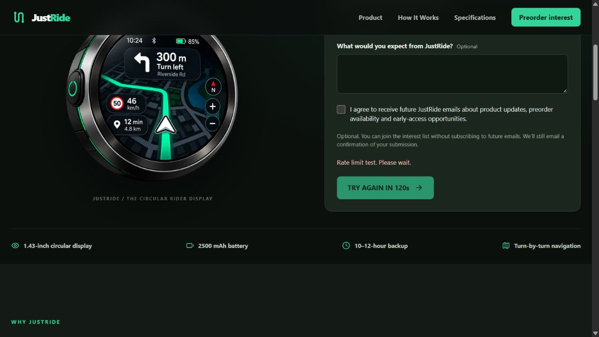

# JustRide API, device asset and reliability audit

Date: 17 October 2026. Status: implemented and verified as described below; prepared for GitHub publication at the user's request. Deployment verification, physical device and production load certification remain outstanding.

Cleanup: JavaScript test files and their npm command were subsequently removed at the
user's explicit request. JavaScript test results below are historical results from before
removal; the suite is no longer included. Mobile Dart tests were not removed.

Follow-up: confirmation emails now use a MongoDB outbox and Vercel `waitUntil` rather
than blocking submission completion. New records save as `queued`; duplicate email
submissions do not create another queue entry. A persistent Node worker and subsequent
submission/admin-view background drains recover queued entries. Ambiguous SMTP sends
are not automatically retried. See [current email behavior and recovery limits](transactional-email.md).
Five additional queue regressions cover nonblocking responses, concurrent duplicate
inserts/workers, deferred quota failures, ambiguous-timeout suppression and a DB failure
after provider acceptance. Installing the official background helper also surfaced npm
audit notices in existing dependencies (10 advisories, including a critical proxy-addr
advisory); dependency remediation was not bundled into this email-flow change.

Consent follow-up: the interest form now requires an unchecked-by-default email consent
checkbox before submission. The API requires explicit boolean true and the queue refuses
to send previously queued records without saved consent. Interest buttons now say
"I'm Interested"; admin shows consent as Confirmed or Not confirmed. Consent confirmation
means the submitted checkbox choice, not proof of email address ownership.

## 1. Architecture and API inventory

- Express 5 / Mongoose backend, MongoDB persistence, existing Redis REST/TCP clients, BullMQ queues, Socket.IO chat, Cloudinary images and R2 release downloads.
- React/Vite customer and staff websites. Customer interest submissions persist through `/api/early-interest`; ADMIN/HELPER reads remain protected and the existing Interested Users page remains connected.
- Flutter mobile client calls `https://backend.justride.cc/api`. Device pairing and release metadata use HTTP; navigation, GPS display synchronization and OTA chunks use BLE. Local ride/session persistence and direct Google Maps calls have no equivalent backend ride/telemetry endpoints.
- Firmware navigation heartbeat is approximately 250 ms (4 updates/sec). OTA transfers use the existing 128-byte BLE chunk protocol and sequence checks. HTTP quotas therefore do not throttle these streams. No firmware source or protocol was changed.

The complete [113 method/path inventory](api-inventory.md) includes controller, auth/role, estimated frequency, every overlapping policy, scope and justification. [Machine-readable inventory](api-inventory.json) also includes source paths and outage decisions. Regenerate with `node scripts/api-inventory.js`. Express-generated HEAD/OPTIONS behavior and Socket.IO transport are not separate business HTTP endpoints in this inventory.

Source-derived traffic estimates:

| Caller | Normal request generation | Change |
|---|---|---|
| Mobile dashboard/device screen | Status timer every 20 seconds, 3 reads/min per mounted screen, plus opening/manual refresh | Concurrent reads for the same auth token now share one request; later checks remain fresh |
| Staff dashboard | Stats and admin health every 60 seconds plus refresh | Hidden-tab timer skips requests; helpers skip ADMIN-only health |
| Customer interest form | Explicit submission | 429/503 countdown prevents repeated submissions; no automatic POST retry |
| Profile, support, addresses, notifications, catalog | View/open, refresh or explicit action | Category limits and duplicate staff GET coalescing |
| Navigation and OTA | BLE updates/chunks, not backend HTTP | Existing timing and protocol preserved |

These frequencies are source estimates, not production traffic measurements. Existing cache service and firmware catalog TTL are reused, not duplicated. Mongo connection setup and queue infrastructure remain in place.

## 2. Rate limiting

Configuration: `src/security/rateLimitPolicies.js`. Middleware and identities: `rateLimiter.js`. Atomic storage: `rateLimitStore.js`.

- Redis sorted-set exact sliding windows use Redis server time, unique request IDs, one atomic Lua EVAL per applied policy and key expiration. A key stores at most its configured limit. Requests can consume multiple category budgets; the inventory lists them all. Exhausting any one rejects the request.
- A secondary 1,200 requests/minute IP ceiling protects the entire HTTP app. Public reads get 60/minute. Login gets 5/15 minutes per normalized submitted account identifier plus IP, with a secondary 100/15-minute IP auth ceiling. Registration is 5/hour/IP; password reset 3/hour/account+IP; OTP send 3/10 minutes/user and verification 5/10 minutes/user.
- User reads 60/minute, writes 30/minute, profile changes 10/minute. Device reads 60/minute, writes 20/minute, registration 5/hour, pairing 10/10 minutes. Staff reads 120/minute and writes 30/minute. Uploads 10/hour, before multipart parsing. Both device registration routes share the same budget.
- REST and Socket.IO message sends share 10/5 seconds/user across reconnects and backend workers. REST writes also consume their broader write budget.
- Authenticated identities come from `protect`, never an arbitrary device identifier. Pairing and OTP limits deliberately aggregate by verified user; changing device aliases/challenges cannot reset a quota. They are stricter than the proposed user+device scopes for multi-device accounts.
- Refresh is 20/minute per verified refresh account, stable across JTI rotation. The current JWT schema has no stable session-family ID, so multiple sessions of an account share this budget. Invalid refresh credentials use IP scope.
- Keys hash identity material; no email, OTP, bearer token or refresh token is stored in a limiter key. IPv6 grouping uses the installed `express-rate-limit` helper's default /56 subnet. Authenticated users behind one NAT have separate primary budgets; public/global secondary IP budgets remain shared.
- IP comes from Express `req.ip`, with socket fallback. Raw forwarding headers are not read by the limiter or audit logger. `TRUST_PROXY` accepts deployment-controlled trusted addresses/CIDRs; default is false, or one platform hop for Vercel. Verify the actual production proxy path before rollout.
- Responses use consistent 429 JSON, integer `Retry-After`, `RateLimit-Limit`, `Remaining`, `Reset`, and `Policy`. CORS exposes these headers.
- Store failures allow reads, logout and secondary global protection to continue, with degraded counters; sensitive writes/auth/OTP return 503 and Retry-After 5. Production never silently substitutes process-local counters. Development memory storage is explicitly labeled and capped at 10,000 keys.
- Process counters are exposed in ADMIN-only `/api/admin/dashboard/health` under `rate_limiting`. These reset on process restart and are not a fleet-wide monitoring system. Store warnings are redacted and HTTP warnings are bounded to once per 30 seconds.
- No automatic mutation retry was introduced. Existing BLE transfer retry behavior is preserved. The Redis limiter client disables request replay and bounds store calls to 1.5 seconds; this avoids consuming a window repeatedly after an ambiguous response.

## 3. Authentic device images

The latest circular front/side images were already approved by the user and present in customer assets. They were converted directly, without inventing or redrawing the device.

| Asset | Original bytes | Optimized bytes | Measured reduction |
|---|---:|---:|---:|
| `188e6367-079b-475e-9a8b-2baa4892a8b1.png` front | 1,625,751 | `device-front.webp`: 173,054 | 89.35% |
| `9c3507fa-ce34-4cf7-a760-5eb71893c492.png` side | 687,972 | `device-side.webp`: 60,672 | 91.18% |
| Front small derivative | — | `device-front-480.webp`: 37,010 | 480px responsive source |
| Side small derivative | — | `device-side-480.webp`: 11,500 | 480px responsive source |
| Mobile front derivative | — | `assets/justride-device.webp`: 61,232 | 640px bundled source |

`DeviceImage.jsx` centralizes responsive `srcSet`/sizes and original-PNG fallback. Homepage, product gallery, about, download and legacy home sections use it. Existing alt text, aspect ratios, lazy loading and hero priority remain. Mobile home/device card use the circular derivative with contain sizing. Generic Bluetooth/pairing icons are functional icons, not outdated product photographs, and remain.

Both homepage device images loaded successfully from the 480px WebP sources in the local browser. Original PNGs remain required fallbacks. The user's untracked duplicate `(1).png` and mobile legacy PNG were not deleted because they predate this task. Forced image-load failure and physical mobile asset rendering were not exercised.

## 4. Confirmed bugs and corrections

| Bug | Severity | Root cause | Correction | Verification |
|---|---|---|---|---|
| Distributed quotas were inconsistent | High | Existing API/auth counters were per process and categories shared overly broad budgets | Atomic shared Redis category windows and stable identities | All policy boundary/expiry tests; live two-client Redis test |
| Chat reconnect reset message budget | Medium | Quota was stored against socket ID in a process Map | Verified-user budget shared with REST | REST plus nine reconnects exhaust one ten-message budget |
| Other users' cloud images could be deleted | High | Client supplied unrestricted public ID/folder | Server-owned user folder, identifier checks, confirmed provider result | Owner/cross-owner/traversal/provider-failure regression |
| Default administrator and password logging | High | Bootstrap used a hardcoded default and logged password | Explicit seed opt-in and env credentials, no credential logging | No DB lookup when seeding disabled |
| Weak numeric OTP randomness | High | Math.random generated sensitive OTP | crypto.randomInt | Regression rejects any Math.random use |
| Public HMAC default secret | High | Hardcoded shared fallback | Explicit per-device or environment secret; no public default | Missing-secret and custom-secret tests |
| Blocked device passed availability check | High | Projection omitted lifecycle fields | Include blocked/retired flags | Controller returns DEVICE_BLOCKED/403 |
| Unlink could affect a changed pairing | High | Read ownership then unconditional update | Compare owner and pairing hash atomically; 409 if stale | Stale-pairing regression |
| Unlink of ownerless record crashed | Medium | Null linked_to dereference | Null ownership guard | Included in source correction; no dedicated DB integration fixture |
| Repeated firmware notifications | Medium | Every check generated the same update alert | Atomic previous-state check; notify only on state/version transition | Two checks produce one notification |
| Reset tokens/internal errors entered logs/responses | High | Raw URL and error stack/message were logged | Safe path, redacted error type, generic production 500 | Redaction regression at logging boundary |
| Mobile transient error cleared device UI or disguised denial | High | All failures could fall back to cached success | Cache only transient responses; preserve failure status/delay; never reuse cache for 401/403; polling preserves current UI | Four mobile regressions, including cached 429 |
| Duplicate reads and hidden-tab polling | Medium | Concurrent callers and unconditional timer | In-flight request coalescing; skip hidden staff timer | Staff and mobile dedup tests; source inspection for visibility |
| Helper health request and hidden Promise rejection | Medium | Helper called ADMIN endpoint; allSettled does not throw | Role-aware health request; surface rejected result | Frontend production build; role path source inspection |
| Interest form repeated rate-limited submissions | Medium | No Retry-After state | Disabled countdown and visible error, preserving entered fields | Isolated browser fixture returned 429; disabled 120-second countdown observed |

## 5. Executed validation

| Check | Result and limits |
|---|---|
| Backend JavaScript suite (subsequently removed) | 48 passed, 0 failed after queue and required-consent follow-ups; live Redis case skipped in normal suite |
| Opt-in live Redis check (subsequently removed) | Passed against configured Redis: 8 concurrent operations through two independent clients allow exactly 3; 200ms window expires. Random `rl:test:` keys expire automatically |
| Staff client checks (subsequently removed) | 3 passed: duplicate GETs, 429 preserving session/no replay, AbortSignal forwarding |
| Existing Flutter suite | 83 tests passed, including existing GPS/navigation/ride-related unit/widget coverage |
| New Flutter test file | 4 passed: Retry-After/auth, transient classification, cached 429 remains failure, concurrent device read coalescing |
| Customer production build | Passed, 1,838 modules; 10.64 seconds in this run |
| Staff production build | Passed, 75 modules; 9.54 seconds in this run |
| Flutter analyzer | Completed with 80 notices: 14 warnings, 66 info, 0 errors. Nonzero exit; see [captured output](flutter-analysis.txt). Existing unused/deprecated/async-context issues remain |
| Firmware `ninja -C build` | Existing incremental build passed. Application binary 0x9dc10 bytes, 63% partition free; no clean rebuild/flash |
| Local homepage browser | Front/side responsive WebP loaded; layout inspected |
| Customer 429 browser fixture | Entered test fields retained and submission disabled with countdown; backend/email never contacted |
| Backend syntax / whitespace checks | Node syntax checks and git diff --check completed during implementation |

Sandbox initially prevented loopback HTTP tests; rerunning with loopback access passed. Windows Flutter launcher stalled in restricted runs; direct installed Flutter tool snapshot completed the tests/analyzer. These environment failures were not treated as application failures or passing tests.

Boundary tests run every configured policy, including just-at/above-limit, expiry, concurrency, IPv6/NAT identities and store failure/recovery. Endpoint assignments are inventoried from registered routers. This is not an end-to-end exercise of all 113 business controllers against a real database.

## 6. Performance and resource assessment

- Image byte reductions above are measured file sizes. Combined full-size front/side transfer falls from 2,313,723 to 233,726 bytes (89.90%); viewport selection can reduce it further. PNG fallbacks remain in build output but are not normally fetched.
- Controlled duplicate-read tests reduce two simultaneous calls to one HTTP request (50% for that test case); subsequent refresh still makes a fresh request. Production aggregate savings are not measured.
- Staff hidden-tab timer eliminates its periodic requests while hidden; helper dashboard omits one failing health call per refresh. These are source-derived request savings, not production telemetry.
- Each matching policy adds an atomic Redis request. Normal HTTP paths apply global plus category (two operations); sensitive actions can apply three or four. Sequential network latency and paid Redis operation volume must be measured at production load. No before/after API latency or database throughput benchmark was available, so no throughput speedup is claimed.
- Sliding-window sets are bounded by policy limit and inactivity TTL. Active hostile identity cardinality, Redis eviction and provider quotas still require infrastructure monitoring. There is no global fleet memory bound beyond provider capacity.
- The live Redis integration body ran in approximately 762ms during the executed check; this is test duration, not an endpoint p95 latency measurement.

## 7. Files changed by this task

Paths in this section are relative to the named repository. Other dirty mobile/firmware files existed before this task and are not attributed to this work.

### Backend

| Files | Reason |
|---|---|
| `package.json` | Enable actual Node test command |
| `src/models/EarlyInterest.model.js` | Persist and validate optional price ranges; regression checks were subsequently removed |
| `src/security/rateLimitPolicies.js`, `rateLimitStore.js`, `rateLimiter.js` | Policies, atomic shared storage, identities, errors and counters |
| `src/app.js` | Trusted proxy configuration, secondary ceiling, catalog reads, exposed headers |
| `src/routes/userRoutes.js`, `adminRoutes.js`, `deviceRoutes.js`, `earlyInterestRoutes.js`, `chatRoutes.js`, `notificationRoutes.js`, `savedAddressRoutes.js`, `supportRoutes.js`, `uploadRoutes.js` | Attach category/action budgets after auth and before uploads |
| `src/socket/chat.socket.js` | Shared message-send quota across transports/reconnects |
| `src/controllers/admin/dashboard.controller.js` | ADMIN process rate-limit metrics |
| `src/controllers/device/pairing.controller.js` | Lifecycle projection, ownership guards, stale unlink protection and correct device secret selection |
| `src/controllers/device/firmware.controller.js` | Avoid repeated identical update alerts |
| `src/controllers/upload.controller.js`, `src/services/cloudinary.service.js` | Upload ownership/dimension restrictions; propagate provider deletion failure |
| `src/config/seedAdmin.js`, `src/utils/deviceCrypto.js` | Explicit secure bootstrap and cryptographic OTP/HMAC configuration |
| `src/middlewares/errorHandler.js`, `src/security/auditLogger.js` | Redacted error logs and trusted IP use |
| JavaScript regression fixtures (subsequently removed) | Verified rates, security, queueing, consent, price ranges and staff access before cleanup |
| `scripts/api-inventory.js`, `docs/api-inventory.md`, `docs/api-inventory.json` | Reproducible inventory |
| `docs/engineering-report.md`, `docs/flutter-analysis.txt`, `docs/interest-429.png` | Report and validation evidence |

### Customer website

- `src/assets/device.js`: front/side optimized and fallback source mapping.
- `src/assets/device-front.webp`, `device-front-480.webp`, `device-side.webp`, `device-side-480.webp`: approved image derivatives.
- `src/components/common/DeviceImage.jsx`: reusable responsive image/fallback.
- `src/pages/EarlyAccessPage.jsx`: responsive device images and Retry-After form state.
- `src/pages/ProductPage.jsx`, `AboutUsPage.jsx`, `DownloadPage.jsx`, `HomePage.jsx`: same authentic image component.
- The temporary `test/interest-harness.html` browser fixture was removed after verification; the captured evidence remains below.

### Staff website

- `src/api/client.js`: concurrent GET coalescing, cancellation forwarding, retry metadata.
- `src/pages/admin/AdminDashboard.jsx`: role-aware/visible polling and rejected-request error display.
- `src/pages/admin/InterestedUsers.jsx`: show the customer's preferred price range.
- Staff JavaScript client regressions were verified and subsequently removed.

### Mobile

- `lib/core/network/api_client.dart`: production backend host, retry metadata, transient failure classification (file already contained user edits).
- `lib/core/services/backend_service.dart`: in-flight device reads, auth race guard, denial handling and honest cached transient response.
- `lib/features/dashboard/screens/dashboard_screen.dart`, `lib/features/device/screens/device_screen.dart`: preserve device state during transient errors and show initial fetch error.
- `lib/features/dashboard/screens/home_screen.dart`, `lib/features/dashboard/widgets/device_card.dart`: approved circular image (both had prior edits).
- `assets/justride-device.webp`, `pubspec.yaml`: bundle optimized mobile image.
- `test/api_rate_limit_test.dart`: four focused regressions.

## 8. Deployment and remaining risks

1. Configure Redis REST URL/token (preferred here), or enabled TCP Redis, in the actual backend deployment environment. Keep credentials in deployment secrets/ignored env. Confirm rate counters cannot be evicted under normal load: the existing Redis environment previously reported `optimistic-volatile` eviction. Evicted keys weaken enforcement. No provider policy was changed by this task.
2. Set `TRUST_PROXY` to the trusted production proxy addresses/CIDRs when applicable. A false default behind an unconfigured proxy shares one upstream IP quota; overly broad trust allows spoofed IPs. Validate using real requests through backend.justride.cc.
3. Existing administrators remain. This change prevents new insecure default seeding; it does not rotate or revoke any account that may have been created previously. Explicit bootstrap needs `SEED_ADMIN=true`, email, username and a password of at least 12 characters.
4. Ensure per-device secrets or the intentionally configured legacy `DEVICE_SECRET` exist. Provisioning without a secret now fails rather than using a public default. No deployed device credential migration was performed.
5. Legacy cloud uploads in shared folders cannot be securely attributed from their public ID alone. Their direct-delete request is now rejected. Migrate owner metadata or clean legacy files through an authorized admin workflow; do not reopen arbitrary deletion.
6. Primary account+IP login protection uses the submitted normalized identifier; multiple aliases or many IPs are not a global per-account lockout. An edge/WAF and operational abuse monitoring remain useful. Legitimate public users sharing an IP still share anonymous quotas.
7. Refresh, OTP and pairing limits deliberately aggregate per account/user. Validate expected multi-device/multi-session usage before changing thresholds. Inventory scopes accurately describe the implementation, rather than claiming trusted device/challenge IDs that middleware does not yet possess.
8. Simultaneous pairing across different devices for one user still needs a dedicated Mongo transaction/index migration if a strict one-device-per-user invariant is required. Existing data was not changed or reindexed. Compare-and-set unlink protection is tested, but does not solve every pairing race.
9. Socket message sends are shared and bounded. Connection, room-join and typing-event flood controls remain separate infrastructure/application work; HTTP endpoint protection does not automatically rate-limit every WebSocket event.
10. Physical BLE disconnect/reconnect, active ride restoration on a real restart, interrupted/resumed OTA and release downloads were not exercised with hardware. Existing unit tests and incremental firmware build are not hardware certification. No firmware was flashed and no mobile APK was built in this task.
11. Analyzer is not clean: 14 warnings and 66 info notices remain in the existing mobile code, including async BuildContext use. No backend/staff lint script exists; production builds and Node tests were used.
12. Mongo-backed controller authorization tests here use fixtures/mocks for targeted cases. Full all-endpoint DB integration, fleet load/latency tests, monitoring alert thresholds and canary rollout are still needed before claiming production readiness.

## Browser evidence

Follow-up: the customer interest form now includes optional preferred price ranges ₹4,999–₹5,999, ₹5,999–₹6,999, ₹6,999–₹7,999 and ₹7,999–₹8,999. The backend validates and stores the choice; Interested Users shows it. Existing clients may omit the field and older records remain readable. Backend regression and both production website builds passed after this addition.

The following isolated fixture demonstrates the real interest form's 429 handling. It sends no email and saves no interest record.

